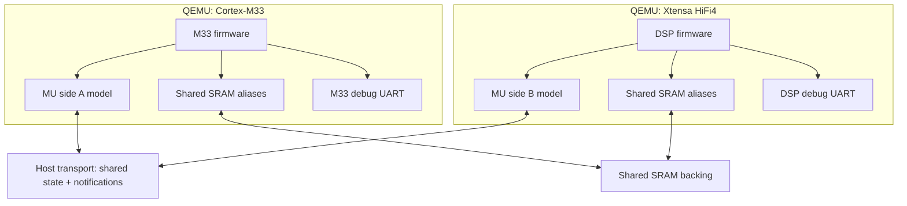

# i.MX RT685 dual-QEMU design and implementation plan

Date: 2026-10-27  
Status: revised design proposal; source-inspected, not built or validated against your packs, QEMU tree, or installed toolchain

## 1. Goal and acceptance criteria

Run the existing Cortex-M33 EVK machine and a new RT685 Xtensa machine as separate QEMU processes on one host. For the first milestone, execute code on both cores, exchange messages using an emulated RT685 Messaging Unit (MU), service the corresponding guest interrupts, and print observable results to separately captured debug UART streams.

**Milestone M1 passes when:**

1. Both guest images execute, each emits an identifiable UART banner, and M33 and DSP output can be captured independently.
2. A bidirectional sequence of at least 100 numbered MU request/reply exchanges completes with correct values and no timeouts or duplicate deliveries. At least one receive on each core must be interrupt-driven; the UART log identifies the ISR and the received sequence.
3. Receiver interrupt masking, pending state, acknowledgement and re-enabling behave as required by the SDK example and reference manual; a message remains pending while masked and is delivered once unmasked.
4. Both start orders and repeated clean runs pass. Disconnect/restart behavior is explicit and fails clearly rather than silently corrupting state.
5. The SDK `dsp_examples/mu_interrupt` is the target integration test, ported to the Zephyr SDK RT600 GCC toolchain as necessary. Document any patches, UART adaptations, missing board functions, and exact SDK revision. A GCC-compatible port with documented replacements for XOS is acceptable; preserve the NXP MU driver and application protocol where practical. An unmodified XCC/XOS binary is a stretch goal, not an M1 prerequisite. A custom simplified MU test alone is a bring-up step, not equivalent to this criterion.
6. The existing single-core peripheral and FreeRTOS smoke tests continue to pass.

A direct-loaded DSP image and an explicitly released DSP are acceptable for M1, provided the boot shortcut is visible in logs and the test documentation. Hardware-faithful M33-controlled DSP loading/reset follows as a separate milestone.

## 2. Facts, assumptions and early gates

- NXP documents a HiFi4 DSP, shared SRAM and an MU/SEMA42 IPC mechanism. Its SDK provides `mu_polling`, `mu_interrupt`, and `sema42` examples. [NXP system programming](https://docs.mcuxpresso.nxp.com/mcuxsdk/latest/boards/RT/mimxrt685audevk/gettingStartedXplorer/topics/hifi4_system_programming.html).
- By default the DSP starts powered off; M33 configures power, clock and DSP memories, copies the DSP image and releases the DSP stall. SDK examples can instead load DSP binaries from a debugger. [NXP boot and memory map](https://docs.mcuxpresso.nxp.com/mcuxsdk/latest/boards/RT/mimxrt685audevk/gettingStarted/topics/hifi4_boot_loader_and_memory_map.html).
- **Do not assume the Espressif QEMU fork implements the RT685 core or HiFi4 audio instructions.** ESP32-S3's published core configuration explicitly reports `XCHAL_HAVE_HIFI4 0`. Espressif's Xtensa integration is useful reference code, not proof of compatibility. [Espressif S3 core config](https://github.com/espressif/esp-idf/blob/master/components/xtensa/esp32s3/include/xtensa/config/core-isa.h); [Espressif QEMU documentation](https://github.com/espressif/esp-toolchain-docs/blob/main/qemu/README.md).
- The Zephyr board documentation identifies an RT600-specific Xtensa GCC toolchain as well as proprietary Cadence toolchains. Toolchain availability does not establish QEMU execution support. [Zephyr RT685 board](https://github.com/zephyrproject-rtos/zephyr/blob/main/boards/nxp/mimxrt685_evk/doc/index.rst).
- Upstream `ivshmem-flat` requires an ivshmem server; it does not accept a `memdev`, and notification requires a wired IRQ. It exposes the ivshmem guest register protocol, not NXP MU registers. Availability and APIs must be checked in the exact QEMU revisions used. [QEMU ivshmem-flat](https://www.qemu.org/docs/master/system/devices/ivshmem-flat.html).

**Gates before committing to a schedule:** inventory the working Keil BSP/DFP and existing M33 tree, identify the installed Zephyr RT600 GCC version, and build the selected example to obtain its configuration and disassembly. Audit both QEMU branches for `ivshmem-flat`, host support, Xtensa core definitions and instruction decoder coverage. Identify license restrictions for any generated configuration/ISA artifacts. If the DSP binary needs unsupported instructions or unavailable configuration data, M1 is blocked on core support; do not treat an ESP32 core boot as evidence of RT685 compatibility.

## 3. Architecture



Guest software sees the RT685 memory map and MU programming model. The IVSHMEM transport is an implementation detail; the MU model translates register accesses into shared state and peer notifications. This diagram does not imply that attaching two standard `ivshmem-flat` devices automatically provides a host-side MU API: verify whether its implementation can be refactored or wrapped to expose a shared region and receive/send notification to another QEMU device. If not, factor a reusable backend out of the same ivshmem protocol or implement a small compatible client. Preserve upstream behavior where feasible. A guest-visible `ivshmem-flat` device is useful for a transport smoke test but is not itself an RT685 MU.

**Recommended single source of truth:** model one logical MU as two QEMU-side frontends sharing a transport-backed canonical state. Shared SRAM is separate logical storage, even if carved from the same server-provided backing object. Each process owns its local guest interrupt output; a peer notification causes the local frontend to recompute its local interrupt level from canonical state.

**Host compatibility:** first target Linux, where the documented server/eventfd approach is most straightforward. Do not promise macOS support from the Mac's hardware alone: check the chosen QEMU/server implementation for eventfd and Unix descriptor-passing support. If unavailable, implement an alternate notification transport or run the two processes inside Linux. Do not assume Linux eventfd works natively on macOS.

## 4. Memory map and boot

NXP's example linker layout gives these **example ranges**, not a universal SoC mapping:

| DSP view | Example purpose | M1 treatment |
|---|---|---|
| `0x00200000–0x0047ffff` | Code/data SRAM | Shared backing if the DSP ELF or M33 image loader uses it |
| `0x24000000–0x2400ffff` | DSP data TCM | Allocate and map; share if M33 must load it |
| `0x24020000–0x2402ffff` | DSP instruction TCM/vectors | Allocate and map; share if M33 must load it |
| `0x20040000–0x2007ffff` | Noncached inter-core exchange | Shared backing, with actual aliases verified |

Source: [NXP memory map](https://docs.mcuxpresso.nxp.com/mcuxsdk/latest/boards/RT/mimxrt685audevk/gettingStarted/topics/hifi4_boot_loader_and_memory_map.html). Extract exact addresses and sizes from the selected linker scripts, device headers and RT6xx reference manual, not from this table alone. Some address ranges are aliases of the same physical SRAM. Model each physical bank exactly once and map aliases to offsets into that same backing; do not create separate arrays for cached and uncached views. Validate M33 and DSP address-to-backing-offset translations for every ELF segment, shared buffer, vector and TCM window. Protect reserved transport metadata from guest mapping. Do not assume the example ranges are independent or infer alias offsets from the listed start addresses.

For first bring-up, the harness starts the DSP QEMU paused, connects both peers, initializes backing before either guest runs, loads each ELF into the correct address space and explicitly releases both. Since two QEMU loaders could overwrite shared RAM, define a single loader owner for each physical range and disable the other loader for that range. Check ELF `PT_LOAD` physical/virtual addresses, entry/reset vector and BSS handling; verify with debugger reads from both processes. Do not clear backing when the second peer attaches.

Initially, DSP boot may use a clearly labeled **direct-load mode** with an appropriate reset vector and entry; it bypasses M33 power, copy and stall control. Later add a cross-process control channel so M33's modeled DSP power/reset/stall state controls DSP execution. M33 `DSP_CopyImage` must write the same physical TCM/SRAM backing the DSP executes. Do not claim the direct-load milestone validates `DSP_Start()`.

Code modified by the other process is a special case: QEMU's translated-block cache does not automatically become coherent merely because another process changes shared host memory. For M1, finish loading before DSP execution and keep code immutable, including on restart. Future dynamic image loading or self-modification requires explicit cross-process invalidation or a stop/reload/reset protocol tested for stale translations.

## 5. MU implementation

### Register behavior

Create a device model with two logical endpoints A and B. Before coding, build a register matrix directly from the reference manual and the SDK driver for the selected silicon revision: base addresses as seen by both cores; register width/access permissions; reset values; transmit/receive register count; status and interrupt-enable bits; write-one-to-clear/read side effects; full/empty and overrun behavior; general-purpose interrupts/flags; and each side's IRQ routing through the interrupt mux and Xtensa interrupt level. Record only verified numbers in code. No addresses, register bit positions, or vector numbers in this plan are guesses.

On a guest MMIO access:

1. Lock canonical MU state; apply the hardware-defined operation atomically, including status and side effects. For a transmit, update the receiver-visible slot and pending state before notification.
2. Under the same synchronization, calculate affected local/remote conditions and advance a notification generation counter. Release the lock.
3. Recompute the local IRQ in the QEMU main-loop context. Notify the remote process when its state may have changed; on notification it locks, re-reads state and recomputes its local IRQ. Do not call QEMU IRQ APIs directly from an arbitrary I/O thread.
4. Status is authoritative; doorbells are wakeups, not individual message counts. Coalescing, spurious notifications and sender/receiver scheduling must not lose a pending interrupt. Explicitly test transitions in both directions, mask/unmask, clear and read-to-consume as specified by the manual.

Use a versioned, fixed-width shared control layout with magic, version, total size, session generation and endpoint state. Specify byte order, alignment and field ownership. Do not store host pointers or `pthread_mutex_t` in a supposedly portable wire layout. Use a properly process-shared synchronization primitive on the supported host, or an external authoritative MU owner; QEMU's in-process BQL is not a cross-process lock. Define lock recovery or abort the session on peer death, and avoid holding a lock while invoking callbacks or transport operations. Never assume guest `volatile` provides interprocess atomicity or ordering. Use release/acquire synchronization appropriate to the host and compiler. The transport must provide publish-before-notify and recheck-after-wakeup guarantees; test on both x86-64 and ARM64 hosts where available.

**Race prevention:** register the notification handler before reporting ready; recheck canonical state after enabling notifications and before sleeping. Coalesced notifications are harmless because the receiving side derives IRQ level from state. A receive/clear race must be serialized by the same shared lock. Do not use eventfd count as message state.

### Peripheral ownership

Do not duplicate a single physical UART or other stateful peripheral independently in each VM. For M1 choose two distinct Flexcomm USART instances if supported by the board configuration; instantiate one local model per instance and wire each to a different chardev, with M33 performing whatever clock/pin setup the real example requires. Confirm exact instance/base/pins from the selected SDK. If both examples use the same USART, either assign the DSP an explicitly documented test-only second UART or implement a shared owner; separate logs alone do not prove two hardware UARTs exist. NXP documents a DSP USART hello-world example. [NXP DSP USART example](https://mcuxpresso.nxp.com/mcuxsdk/26.06.00/html/examples/dsp_examples/hello_world_usart/readme.html).

For later shared peripherals, choose **one owning QEMU process per device**. The other side forwards MMIO requests to that owner via a separate request/reply channel; the owner performs register side effects, DMA against shared physical RAM, and routes device IRQs to either core through notifications. Shared-memory copies of register arrays are not sufficient for FIFO, DMA, timer, or clear-on-read semantics. Specify timeout, ordering, reset and asynchronous IRQ handling before implementing this bridge; avoid synchronous RPC while holding QEMU locks that the peer needs.

## 6. Xtensa core feasibility and implementation

1. Pin the existing ARM QEMU SHA and inspect its `target/xtensa`, upstream baseline and Espressif fork at exact SHAs. Diff Xtensa TCG changes, CPU configuration mechanisms, generated decoder artifacts, interrupt and reset handling, and any patches needed for the chosen host. Build both `arm-softmmu` and `xtensa-softmmu` where supported. Keep independent binaries if merging branches is costly; make transport protocol compatibility an explicit contract.
2. Obtain RT600 core headers/configuration and compare instruction options, endianness, windowed/call ABI, exception/vector placement, interrupt levels, timers, debug registers, memory attributes and coprocessor settings to available QEMU core models. Inspect `xtensa-nxp_rt600_adsp_zephyr-elf-objdump -d` or the equivalent configured toolchain on the actual DSP ELF, including startup and libraries. This identifies instructions encountered, but disassembly alone does not prove semantics are implemented.
3. First run a tiny assembly image built for the actual RT600 core: register arithmetic, loads/stores, branch, exception/vector and interrupt return. Bring up one low-level UART write. Add RT685 core configuration and missing instruction translations as needed, with focused instruction-level tests. Check coprocessor enable/context and HiFi instructions if emitted. A base-Xtensa subset may permit the mailbox test, but must be verified in execution and must not be advertised as full HiFi4 support.
4. Instantiate a dedicated Xtensa machine with verified memory regions, reset/exception vectors, interrupt controller inputs, MU and UART, referencing existing Xtensa machines as patterns. Add trace events for exceptions, unknown MMIO, IRQ levels and MU transactions. Do not blindly transplant ESP peripheral models or ESP core parameters.
5. Run the SDK DSP UART example, then the MU examples. If unsupported instructions are hit, capture PC, opcode and disassembly, implement/test the required semantics or select a compatible build configuration; do not silently NOP instructions.

**Go/no-go:** if the needed RT600 core metadata or instruction semantics cannot be obtained or legally used, report the blocker and scope. Consider a Cadence ISS connected to the same transport if available, or a limited base-ISA test to validate the interprocess infrastructure. Neither substitute establishes execution of the target HiFi4 firmware.

## 7. Transport and lifecycle

- Start an ivshmem server and both QEMUs using a per-run private socket and backing object; use the server's actual revision-specific command help rather than assuming CLI flags. Confirm backend mapping size, file descriptor ownership, peer IDs and notification vectors from the implementation. A test-only guest-visible ivshmem device can first prove two-way RAM writes and interrupts, then be removed or disabled for the MU acceptance test.
- Assign stable roles through an explicit handshake, not connection-order peer IDs. Exchange session ID, protocol version, role, backing size, layout hash and current dynamic peer ID. Fail fast on mismatches or duplicate roles. Handle peer ID reuse on reconnect; never keep stale routing after disconnect.
- A small test harness owns startup, logs and teardown. It creates a fresh session, starts server and QEMUs, waits for connection and device readiness, then releases guests; it imposes a timeout and terminates all children on failure. On one peer exiting, mark session failed, stop the other guest and discard state. M1 does not promise transparent reconnect.
- Define whole-system reset as an orchestrated stop of both cores, reset MU once, clear or preserve SRAM according to the chosen reset semantics, increment session generation and resume. Individual CPU reset must not silently reset the shared MU twice. Test reset while idle; reset during traffic may fail the run in M1. Do not claim migration, record/replay or deterministic timing support until coordinated snapshots and event ordering are designed.
- Host wall-clock scheduling is asynchronous; do not compare cycles or assume a shared virtual clock. All waits use timeouts generous enough for TCG and host scheduling. Avoid polling loops that starve the peer.

## 8. Work packages and verification

| Phase | Deliverable | Verification / exit gate |
|---|---|---|
| 0: Audit | Version-pinned feature matrix, core and firmware disassembly, memory/IRQ/register maps, toolchain/license decision | Resolve HiFi4 instruction feasibility and IVSHMEM backend availability; document blockers |
| 1: Transport | Minimal two-process harness, shared memory and notifications | Exchange patterned bytes both directions; mask/unmask, coalescing, start order, disconnect and fresh-session tests |
| 2: DSP core | RT685 Xtensa machine, memory and UART; simple target binary | Correct reset/exception flow and independent DSP UART banner; run actual SDK UART example if feasible |
| 3: MU model | Paired MU devices, shared state, interrupt routing and traces | Register/side-effect tests and polling ping-pong; qtests where viable plus real two-process integration tests |
| 4: M1 | Interrupt-driven SDK mailbox integration and test runner | All acceptance criteria in section 1, plus regression of existing ARM tests |
| 5: Boot fidelity | M33 image copy and DSP stall/reset control | M33 loads DSP image into shared physical regions, releases it, and both cores complete the same MU test; validate reset and translated-code invalidation |
| 6: Shared devices | Explicit peripheral owner and remote MMIO/DMA bridge | Start with a low-rate device; then I2S DMA using shared buffers, with interrupt routing and reset tests |
| 7: DSP audio | Required HiFi4 instructions, DSP libraries, IPC and audio pipeline | Compare deterministic audio blocks against a reference implementation or hardware; measure host performance separately |

No schedule is asserted without inspecting your fork, DSP binary and QEMU versions. Critical path is core ISA/configuration feasibility, followed by transport integration and faithful MU semantics; these can be investigated in parallel.

### Specific integration tests

- **MU correctness:** transmit in each direction; full/empty behavior; receive side effects; pending before enable; clear/deassert; reassert on new message; repeated enable/disable; both cores transmit concurrently. Expected values come from manual and driver, not implementation assumptions.
- **Shared memory:** write unique patterns through every relevant alias, read from both cores, test bank boundaries and ensure no unintended overlap. Test loaders with both start orders.
- **Interrupt proof:** log write, canonical state change, notification, local IRQ assertion, guest ISR entry, guest acknowledgement and IRQ deassertion with session ID and sequence. A UART reply alone can be produced by polling; ISR entry must be verified.
- **Lifecycle:** missing peer, wrong protocol, duplicate role, early peer exit, hung peer, session restart, whole-system reset and cleanup; no state carried between runs.
- **Regression:** pre-existing audio DMA, SPI, I2C, UART and FreeRTOS tests, prioritizing existing automated tests. Measure test timeouts on the slowest supported host.

## 9. Proposed code organization

Paths below are illustrative and should follow the existing tree's conventions:

```text
hw/xtensa/imxrt685_dsp.c       Xtensa machine and address-space wiring
hw/misc/imxrt685_mu.c          MU endpoint and register behavior
hw/misc/imxrt685_ipc.c         transport adapter and session state
include/hw/misc/               device and transport interfaces
hw/arm/                        minimal changes to existing RT685 machine
 tests/qtest/                   MU register tests where supported
 tests/integration/rt685/       dual-process harness, binaries and checks
```

Share common device code across targets using QEMU's build system; avoid binding the MU model to Xtensa or Arm target-specific types. Separate guest-facing MU from transport backend so a test backend can deterministically exercise register semantics. Maintain a manifest recording SDK, toolchain, ARM QEMU, Xtensa QEMU, server and protocol versions.

## 10. First practical steps

1. Inventory the working M33 project and exact Keil BSP/DFP revisions; build the legacy DSP `hello_world_usart` using the installed RT600 GCC, following section 11, then obtain its ELF and linker map. List unsupported features and all startup MMIO/interrupt dependencies.
2. Inventory the exact RT600 core options and compare against QEMU and the DSP binary. Determine whether the mailbox path can execute without unsupported HiFi4 operations.
3. Inspect the existing ARM machine's SRAM aliasing and MU/DSP control models; produce a verified address-to-physical-bank table and a shared-memory ownership plan.
4. Prototype a tiny two-process transport and isolate the choice between adapting `ivshmem-flat` internals and implementing a compatible backend. Prove notification delivery on the intended host.
5. Bring up DSP UART, then implement MU register semantics and polling, then interrupt-driven traffic. Finally switch from direct load to hardware-like M33 control.

The milestone intentionally proves real MU-style synchronization and separate observable outputs. It does not yet prove cycle accuracy, DSP audio instruction completeness, hardware cache behavior, arbitrary cross-process peripheral sharing, or hardware-faithful boot.


## 11. DSP example port: Zephyr SDK GCC and the working Keil-pack environment

### 11.1 Inputs, boundaries, and evidence

The user already has a working M33 QEMU environment based on a Keil RT685 EVK board support pack and SoC device support pack, plus the Zephyr SDK RT600-specific GCC toolchain. These are inputs, not evidence that the packs contain DSP-specific startup, HiFi4 device headers, XOS, or DSP drivers. Determine exact pack vendor/name/version, .pdsc files, package variants and component provenance by inspecting the installed files. The Zephyr board guide confirms `xtensa-nxp_rt600_adsp_zephyr-elf` supports this target in Zephyr, not that it supplies a standalone MCUXpresso/XOS runtime: [Zephyr RT685 board guide](https://github.com/zephyrproject-rtos/zephyr/blob/main/boards/nxp/mimxrt685_evk/doc/index.rst).

The goal is **a separate DSP GCC executable integrated beside the existing pack-based M33 build**, not recompiling Arm startup objects with Xtensa GCC or replacing a known-good Arm project with Zephyr. Reuse source code and register definitions where they are demonstrably architecture-neutral, compatible and version-matched; use HiFi4-specific headers and support where appropriate. Headers are build inputs, not proof that ARM objects, libraries or startup are link-compatible with Xtensa. Preserve the legacy example's NXP source, retain licenses and record patches; do not assume files from distinct SDK/pack revisions are interchangeable.

### 11.2 What the selected legacy source actually does

- DSP [main_dsp.c](https://github.com/nxp-mcuxpresso/legacy-mcux-sdk-examples/blob/main/evkmimxrt685/dsp_examples/hello_world_usart/dsp/main_dsp.c) includes `xtensa/config/core.h`, device and console headers. It calls `BOARD_InitBootPins()`, `BOARD_InitDebugConsole()`, prints `XCHAL_CORE_ID`, and loops. It does not demonstrate the MU.
- [board_hifi4.h](https://github.com/nxp-mcuxpresso/legacy-mcux-sdk-examples/blob/main/evkmimxrt685/dsp_examples/hello_world_usart/dsp/board_hifi4.h) selects USART0/FLEXCOMM0, 115200 baud, FFRO and reset/clock controls; [board_hifi4.c](https://github.com/nxp-mcuxpresso/legacy-mcux-sdk-examples/blob/main/evkmimxrt685/dsp_examples/hello_world_usart/dsp/board_hifi4.c) configures them via NXP drivers. [DSP pin_mux.c](https://github.com/nxp-mcuxpresso/legacy-mcux-sdk-examples/blob/main/evkmimxrt685/dsp_examples/hello_world_usart/dsp/pin_mux.c) configures PIO0_1/2. The M33 example configures those same FLEXCOMM0 pins. Confirm the M33 console macros from the selected pack before asserting its UART instance; the example README describes one terminal for both banners.
- [dsp/xcc/CMakeLists.txt](https://github.com/nxp-mcuxpresso/legacy-mcux-sdk-examples/blob/main/evkmimxrt685/dsp_examples/hello_world_usart/dsp/xcc/CMakeLists.txt) provides an actual file inventory: `fsl_adapter_usart.c`, `fsl_usart.c`, `fsl_debug_console.c`, `fsl_assert.c`, `fsl_gpio.c`, `fsl_component_generic_list.c`, `fsl_common.c`, `fsl_common_dsp.c`, `fsl_clock.c`, `fsl_reset.c`, `fsl_flexcomm.c`, `fsl_str.c`, and DSP system code, alongside application and board files. Its XCC options `--xtensa-core`, `--xtensa-system`, `-mlsp`, XOS link, and Xtensa-specific objcopy switches are **not assumed to work with GCC**. The XCC source list is a starting set, not a verified GCC-minimal dependency closure.
- The legacy `min-rt/specs` names Cadence startup objects, vectors and `-lgloss -lminrt -lhal` among other libraries. The presence of this file does not establish that GCC can use it or that its binaries ship with the user's pack/toolchain. [Legacy min-rt specs](https://github.com/nxp-mcuxpresso/legacy-mcux-sdk/blob/main/devices/MIMXRT685S/xtensa/min-rt/specs).
- The legacy [fsl_common_dsp.c](https://github.com/nxp-mcuxpresso/legacy-mcux-sdk/blob/main/drivers/common/fsl_common_dsp.c) calls `xthal_get_ccount()` for `SDK_DelayAtLeastUs`. It may or may not be pulled into the final hello-world link; establish that from the link map. The matching [fsl_common_dsp.h](https://github.com/nxp-mcuxpresso/legacy-mcux-sdk/blob/main/drivers/common/fsl_common_dsp.h) includes no-op compatibility implementations for `EnableIRQ`, `DisableIRQ`, and global IRQ helpers: these must not be mistaken for a functioning Xtensa interrupt port.
- The legacy DSP [mu_interrupt/main_dsp.c](https://github.com/nxp-mcuxpresso/legacy-mcux-sdk-examples/blob/main/evkmimxrt685/dsp_examples/mu_interrupt/dsp/main_dsp.c) includes `<xtensa/xos.h>`, calls `xos_start_main`, sets up the XOS timer, registers and enables DSP interrupt 6, uses MUB and channel 0, sends a boot flag, receives 32 words and sends them back. Its DSP code does **not** initialize the debug console or print a DSP banner. Add explicitly documented UART logging for M1. Do not substitute empty XOS stubs: the interrupt registration and exception return must function. The real IRQ number and mapping must be checked against the exact SDK revision and target configuration before wiring the model.

### 11.3 Immediate local inventory commands

Run these in the user's environment; variables are illustrative and must point at their actual pack roots and SDK. They are read-only and do not modify the working M33 project.

```bash
# Set these to the directories already in use.
export RT685_PACK_ROOT=/path/to/installed/pack/root
export RT685_GCC_PREFIX=xtensa-nxp_rt600_adsp_zephyr-elf-

"${RT685_GCC_PREFIX}gcc" --version
"${RT685_GCC_PREFIX}gcc" -dumpmachine
"${RT685_GCC_PREFIX}gcc" -print-sysroot
"${RT685_GCC_PREFIX}gcc" -print-search-dirs
"${RT685_GCC_PREFIX}gcc" -print-multi-lib
printf '' | "${RT685_GCC_PREFIX}gcc" -x c -E -v -
"${RT685_GCC_PREFIX}gcc" -print-file-name=libgcc.a
"${RT685_GCC_PREFIX}gcc" -print-file-name=libc.a
"${RT685_GCC_PREFIX}gcc" -print-file-name=crt1.o

rg --files "$RT685_PACK_ROOT" | rg -i '(\.pdsc$|MIMXRT685S_dsp|fsl_common_dsp|fsl_(device_registers|usart|flexcomm|clock|reset|debug_console|adapter_usart|iopctl)|xtensa|hifi4|(^|/)board\.(c|h)$)'
rg -n 'CPU_MIMXRT685.*_dsp|__XTENSA__|XCHAL_CORE_ID|xthal_|xos_|__XCC__' "$RT685_PACK_ROOT" -g '*.[chS]' -g '*.pdsc'
```

If `-print-file-name=...` returns only the input name, that file was not found in the driver's search path; repeat for individual startup libraries discovered in link errors. Check whether the toolchain includes actual `xtensa/config/core.h` and related core headers: the include-search output alone doesn't prove any particular header exists. Do not imply the Zephyr SDK toolchain installation includes an entire Zephyr checkout or XOS. For reproducibility record pack versions and SDK revision/hash, compiler `-v`, include paths, `gcc -dumpspecs`, actual flags, linker map and ELF attributes. On Windows adapt the commands to the installed shell.

Inventory table to complete before implementation:

| Component | Preferred source | Validation / fallback |
|---|---|---|
| Arm build, board/clock init, `fsl_dsp` | Existing working project and packs | Preserve build and versions; inspect implementation and `.pdsc` |
| DSP example and board files | Pinned legacy MCUXpresso examples | Keep source or minimal patch with license |
| RT685 DSP register/feature headers and DSP system support | Matching pack if present; otherwise matching legacy MCUXpresso device repository | Confirm `CPU_MIMXRT685SFVKB_dsp` resolves to DSP header; do not reuse M33 system/startup |
| Shared NXP peripheral drivers, console, adapter | Pack if source and device variants match; otherwise compatible legacy SDK sources | Compare APIs, architecture guards and structure definitions; collect provenance |
| Xtensa core config, compiler, binutils, libc/libgcc | Installed RT600 Zephyr SDK toolchain, as actually provided | Locate core headers and inspect ABI, multilib and runtime; Zephyr target support is not a standalone BSP guarantee |
| Reset/vectors/C runtime/interrupts | Dedicated GCC-compatible support after investigation | Derive from compatible sources or deliberately implement; no Arm startup, no unverified binary XOS linkage |
| Linker script | Verified RT685 DSP map adapted to GCC | Inspect legacy LSP and/or Zephyr generated linker; verify target linker compatibility and license |

### 11.4 Choose the runtime path deliberately

**Path A — preferred for the requested environment:** standalone bare-metal GCC DSP executable. Build the NXP hello-world application and peripheral drivers using GCC, an RT685-appropriate Xtensa reset/vector implementation, C initialization and GNU linker script. This preserves the existing M33 Keil-pack setup and avoids making Zephyr a firmware dependency. This path requires creating or sourcing compatible startup, linker and any needed HAL/interrupt support; it is a plan, not a claim that these pieces are present.

**Path B — diagnostic fallback:** build a separate Zephyr HiFi4 app using `west build -b mimxrt685_evk/mimxrt685s/hifi4 samples/hello_world` with a compatible checked-out Zephyr workspace and modules. This checks the installed GCC, RT600 target config and QEMU boot path using Zephyr's own startup and driver integration, but it executes a Zephyr application, not the legacy MCUXpresso DSP example. Zephyr board DTS chooses FLEXCOMM0 and 115200. Inspect generated compile commands, headers, map and linker artifacts for guidance; do not assume extracting Zephyr startup as a standalone object works without its generated code and kernel dependencies. [Zephyr board DTS](https://github.com/zephyrproject-rtos/zephyr/blob/main/boards/nxp/mimxrt685_evk/mimxrt685_evk_mimxrt685s_hifi4.dts).

**Path C — Cadence runtime:** only if a separately licensed, compatible XCC/XOS runtime is actually available and ABI-compatible. Do not assume its libraries can link with GCC. The hello-world XCC build links XOS, but determine which XOS symbols the executable truly needs; the MU interrupt example explicitly uses XOS interrupt APIs and requires a genuine replacement or the original runtime.

### 11.5 Build procedure and expected failure modes

1. Create a separate `dsp/` build tree with its own CMake toolchain file or Makefile. Select `${RT685_GCC_PREFIX}gcc` for C/assembly/linking, `${RT685_GCC_PREFIX}objcopy` and `objdump`; use `CMAKE_SYSTEM_NAME Generic` and `CMAKE_TRY_COMPILE_TARGET_TYPE STATIC_LIBRARY` if using CMake. Keep the existing M33 build separate and orchestrate both at a higher level.
2. Configure include roots and exact DSP macro from the selected SDK. Preserve `CPU_MIMXRT685SFVKB_dsp`, `MCUXPRESSO_SDK`, `-std=gnu99`, and `-fsigned-char` only after checking compatibility with the selected source versions. Use actual toolchain headers for `<xtensa/config/core.h>` if present. Inspect preprocessed `fsl_device_registers.h` to verify the DSP-specific header, IRQ types and correct register map; no silent reliance on Arm-only CMSIS definitions or compiler intrinsics.
3. Translate the XCC CMake file into a GCC source list and include closure. Begin with compilation only, then add dependencies based on errors. Distinguish headers absent, XCC-specific builtins, incompatible compiler attributes/inline assembly, and API drift across pack revisions. Prefer a small compatibility layer over modifying vendor drivers, but implement real semantics rather than empty stubs.
4. Use actual GCC defaults unless the selected startup and all objects require a verified ABI option. Record endianness and `call0` versus windowed ABI; all objects, libc and startup must agree. The XCC example's `-mlsp` is not a portable way to get GCC startup. Read the original linker script's vector, literal, SRAM, TCM and noncacheable placements; adapt syntax and examine its dependencies rather than treating `elf32xtensa.x` as drop-in.
5. Supply a real reset path: correct reset/vector addresses and Xtensa processor state, stack pointer setup for the chosen ABI, required window/exception vectors, `.data` copy when load and run addresses differ, `.bss` zero, optional C library initialization, then `main`. Ensure ELF load segments, linker symbols and startup agree; avoid doing the `.data` copy twice when the loader already places it at runtime address. Preserve separate executable and writable segments and bounds for literal pools. Determine whether XCC's `_sharedvectors`, `_vectors` and runtime helpers are replaceable in this build; don't assume.
6. Add only proven runtime support. If `xthal_get_ccount` is needed, first find an ABI-compatible implementation; otherwise implement a tested equivalent reading the actual Xtensa cycle-count register for the configured core. If assert/console/newlib pulls syscall hooks, supply truthful minimal stubs appropriate for bare metal; do not route UART output through semihosting while calling it an actual USART test. Investigate clock functions that depend on system-core clock state. Inspect `nm -u` and the link map to find remaining dependencies.
7. Produce `dsp.elf`, map, full disassembly and `readelf -h -l -S -s` output. Verify that image has the expected startup and vectors, no Arm object files, no unexpected unresolved symbols, and memory extents that fit the modeled regions. Compare the NXP XCC section extraction rules before producing any split `.bin` images: GNU objcopy selectors, gaps, zero-fill and destination bases must match M33 `DSP_CopyImage` expectations. For M1 direct ELF load, split images are unnecessary.
8. Execute in QEMU with instruction and MMIO tracing enabled. First verify reset -> C init -> `main`; then pin/reset/clock/USART accesses; finally capture the DSP banner. An illegal instruction or exception becomes a concrete compatibility case to diagnose at the PC. Work with emitted code rather than assuming all control code is strictly base ISA.

Useful diagnostics once `dsp.elf` exists:

```bash
"${RT685_GCC_PREFIX}readelf" -h -l -S -s dsp.elf > dsp.elf.txt
"${RT685_GCC_PREFIX}objdump" -drwC dsp.elf > dsp.dis
"${RT685_GCC_PREFIX}nm" -n dsp.elf > dsp.symbols
"${RT685_GCC_PREFIX}nm" -u dsp.elf
```

Generate the linker map with the GCC driver's `-Wl,-Map=...` option. A successfully linked binary can still have incorrect vectors, core options or startup behavior; validate those at runtime. Conversely, disassembly containing DSP opcodes is a finding to investigate, not proof all are executed in the hello-world path.

### 11.6 UART and peripheral staging

The DSP example uses FLEXCOMM0 and explicitly touches IOPCTL, reset and clock control as well as USART. For first isolation, instantiate a DSP-local view of the existing FLEXCOMM0 model with a distinct backend, and enough matching control register behavior to satisfy the firmware; record this as a **non-hardware-faithful duplicate**. Do not run two independent models as if they were one shared peripheral. Use unmodified DSP code where feasible.

For a coherent dual-core system choose either: (a) one actual FLEXCOMM0 owner and forwarding from the other QEMU, yielding one physical stream with core-tagged messages; or (b) configure one core to use a different real FLEXCOMM USART and model both, resulting in two true streams, with explicit pin/clock/reset/firmware changes. A host demultiplexer by message prefix is not the same as two independent UARTs. To meet M1's separate streams, option (b) is preferred after bring-up, provided the selected board instance is verified. Separate control blocks must follow the same owner/forwarding principle; no uncoordinated duplicate resets or clock changes.

### 11.7 Transition to MU using the working M33 environment

- First build NXP `mu_polling` on both sides, adapting M33 sources to the current pack only where compatible. Verify MUA/MUB addresses and flags against actual headers; connect paired models and prove data path.
- For `mu_interrupt`, preserve its receive/return protocol while replacing XOS runtime glue with a real bare-metal interrupt implementation, or run an explicitly identified Zephyr-based port. Implement vector entry, context save/restore, register interrupt handler, set interrupt enable, correct level/priority and return; use the RT685 input mux and correct Xtensa interrupt number from the selected revision. A no-op `EnableIRQ` or XOS stub is a failure.
- Add UART initialization/logging to DSP MU example, plus bounded sequential test and completion output to both sides. Log ISR entry in a way that does not re-enter unsafe console code; e.g. record counters in ISR and print them in main. Original example processes 32 words and then blinks LED; 100 exchanges are an intentional test extension, not its native output. Verify no unintended overlap in GPIO, UART, clocks or reset ownership.
- Integrate the existing M33 DSP init in stages: first direct-load with `DSP_IMAGE_COPY_TO_RAM=0` as appropriate and explicit release; later verify M33-created image section files and M33-driven boot. Startup/driver behavior depends on actual build flags; verify them in the chosen project.

### 11.8 Deliverables and acceptance additions

- A reproducible component manifest for pack names/versions, example and SDK commits, licenses, compiler version and GCC/ABI options.
- DSP-specific build files; source provenance and a patch list; linker script and startup; `dsp.elf`, map, disassembly and image-load report. No binary artifact from an unverified Arm or XCC ABI.
- DSP UART output from the real MCUXpresso hello-world source, with startup and USART MMIO traces. Any replacement of `PRINTF`, board code, or drivers must be documented.
- Existing M33 tests passing without regression, then a documented MU port with real Xtensa ISR evidence. For M1, a GCC-compatible MU example is acceptable and the unmodified XOS example is not required.

**Next information needed for actual porting:** the installed pack `.pdsc` files/versions, the working M33 project's build files and QEMU fork location/revision, Zephyr SDK/toolchain version and host OS, and the corresponding legacy SDK core sources or their availability. Inspect these before prescribing exact paths, start files, linker flags or claiming a successful build.
